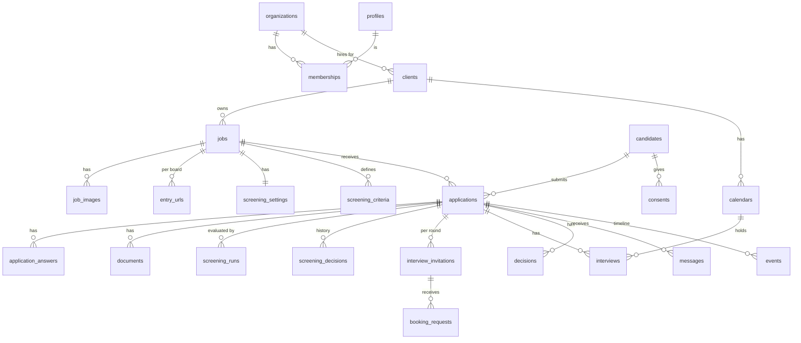
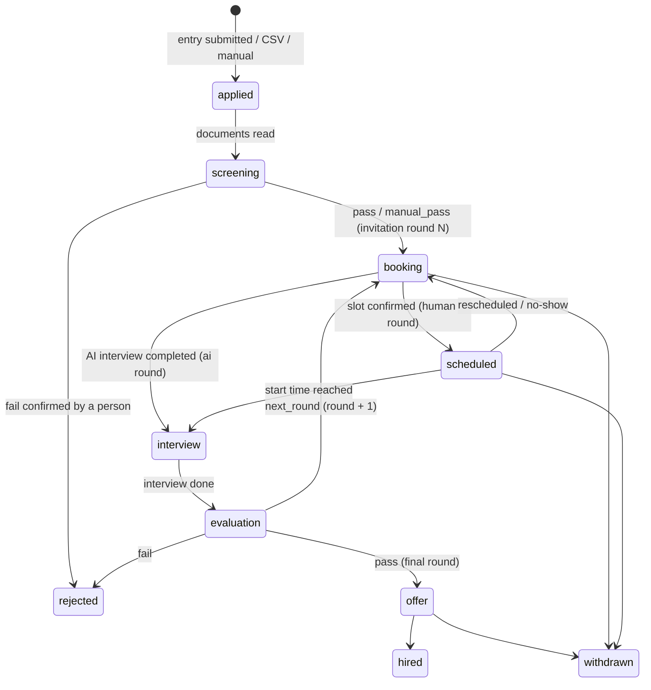
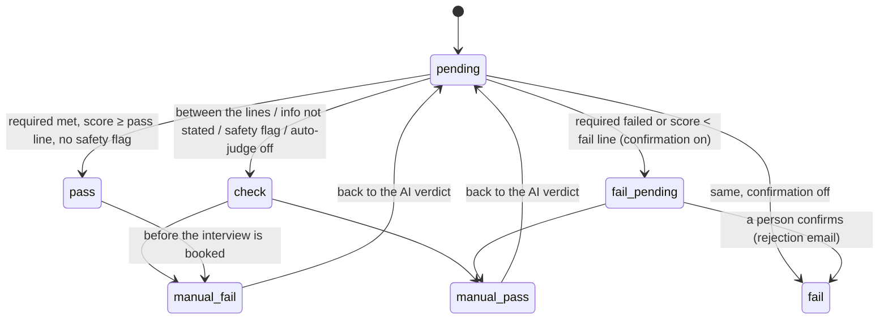

# 04. Data model: mask0

PostgreSQL on Supabase (Tokyo), schema and migrations managed with Drizzle.

**Conventions**
- Primary keys are UUIDv7 (time-ordered; generated in the app, or `uuidv7()` on Postgres 18+).
- **Every tenant table has `org_id`**; client-owned tables also have `client_id`. RLS is enabled on every table ([§6](#6-row-level-security)).
- Timestamps are `timestamptz` in UTC, shown in `Asia/Tokyo`.
- `events` is append-only and is the single source for timelines and analytics.
- Personal data of closed applications is purged after the org's retention period; anonymized events stay for analytics.
- The job-board list changes over time, so `channel` is text validated against a seeded list (plus custom names), not a Postgres enum.

---

## 1. Entity overview



---

## 2. Tables

### Tenancy and access (P1)

| Table | Key columns |
|-------|-------------|
| `organizations` | id, slug (unique), name, kind (`agency` / `inhouse`), plan, sender_name, reply_to, entry_msg_template (must contain `{URL}`), doc_retention_days (30–730, default 180), inbound_local_part (unique), test_mode (log sends without delivering), created_at |
| `profiles` | id (= `auth.users.id`), name, email, avatar_url, locale, last_login_at |
| `memberships` | org_id, user_id, role (`owner` / `admin` / `recruiter` / `interviewer` / `viewer`), client_ids `uuid[]` (null = all clients), status (`active` / `invited` / `disabled`) · PK (org_id, user_id) |
| `invitations` | id, org_id, email, role, client_ids, token_hash, invited_by, expires_at, accepted_at |
| `clients` | id, org_id, name, slug, is_default, logo_path, sender_name_override, settings jsonb · unique (org_id, slug) |
| `integrations` | id, org_id, client_id?, provider (`google` / `zoom` / `microsoft`), account_email, scopes text[], tokens_encrypted, status, connected_by, connected_at (P2 / P3) |

### Jobs and intake (P1)

| Table | Key columns |
|-------|-------------|
| `jobs` | id, org_id, client_id, status (`draft` / `published` / `stopped` / `archived`), title, display_title, posting_fields jsonb (validated by the shared Zod schema), posting_from, posting_to (null = open-ended), requires_cv, ai_interview_enabled (P5), created_by, created_at, updated_at |
| `job_images` | id, org_id, job_id, slot (1–6; 1 = main), storage_path, width, height, bytes, caption (≤ 70) · unique (job_id, slot) |
| `entry_urls` | id, org_id, client_id, job_id, channel (seeded list or custom), code (unique, 6–8 chars), enabled, created_at · unique (job_id, channel) |
| `candidates` | id, org_id, name, name_kana?, email_enc, email_hash, phone_enc, phone_hash, prefecture, city, created_at · unique (org_id, email_hash) |
| `applications` | id, org_id, client_id, job_id, candidate_id, entry_url_id?, channel, source (`entry` / `csv` / `manual` / `test`), **stage**, **outcome**, current_round, verdict, score, waiting_on, next_action, next_action_at, portal_token_hash (unique), other_jobs_opt_in, applied_at, closed_at, close_reason, purge_after · unique (job_id, candidate_id) |
| `application_answers` | application_id, key (`pay_band`, `start_timing`, `criterion:{id}`), value jsonb · PK (application_id, key) |
| `documents` | id, org_id, application_id, kind (`resume` / `cv` / `other`), storage_path, mime, bytes, pages, sha256, uploaded_by (`candidate` / `staff`), uploader_id?, status (`uploading` / `ready` / `rejected`), read_status (`pending` / `done` / `failed`), transcript_text, text_source (`pdf_text` / `ai`), legibility, profile jsonb, read_model, read_prompt_version, created_at |
| `csv_imports` | id, org_id, job_id, file_name, channel, rows_total, rows_created, rows_duplicate, rows_failed, errors jsonb, created_by, created_at |

### Screening (P1)

| Table | Key columns |
|-------|-------------|
| `screening_settings` | job_id (PK), org_id, pass_line (default 70), fail_line (default 40), auto_judge (default true), confirm_rejections (default true), weight_mode (`equal` / `custom`), criteria_version |
| `screening_criteria` | id, org_id, job_id, type (`basic` / `specialist`), label, kind (`choices` / `dropdown` / `range`; basic only), source (`form` / `resume`), config jsonb (choices `{options, pass, multi}` · dropdown `{options, line, dir: "upto" \| "from"}` · range `{min, max, unit}`), required, weight, legal_exception (age conditions: `1` / `2` / `3i` / `3ro` / `3ha` / `3ni`), position, active |
| `screening_runs` | id, org_id, application_id, criteria_version, model, prompt_version, score, verdict_ai, results jsonb `[{criterion_id, value, met \| match, evidence, evidence_verified}]`, flags jsonb `{injection, unverified_evidence, low_legibility, refusal, invalid_output}`, input_tokens, output_tokens, cache_read_tokens, cost_usd, created_at |
| `screening_decisions` | id, application_id, verdict, source (`ai` / `staff` / `confirm` / `revert`), decided_by?, note, created_at (every change is a new row) |

### Invitations, scheduling and interviews (P2, P4)

| Table | Key columns |
|-------|-------------|
| `calendars` | id, org_id, client_id, owner_member_id? (null = the client's shared pool), name, google_calendar_id?, timezone (default `Asia/Tokyo`) |
| `availability_rules` | calendar_id (PK), weekly jsonb `{1: {on, from, to}, …}`, common_from, common_to, slot_minutes (60), buffer_minutes, exclude_weekends, exclude_holidays, window_days (42), min_notice_hours, confirm_mode (`auto` / `manual`), tool, fixed_meeting_url, recorder_enabled, recorder_name |
| `slot_overrides` | id, calendar_id, starts_at, open · unique (calendar_id, starts_at) |
| `concern_options` | id, org_id, client_id, label, answer, position |
| `interview_invitations` | id, org_id, application_id, round, mode (`human` / `ai`), status (`sent` / `opened` / `booked` / `expired` / `canceled`), sent_at, first_opened_at, booked_at, followup_count, expires_at |
| `booking_requests` | id, org_id, invitation_id, preferred `tstzrange[]` (≤ 3), concern_ids uuid[], memo, status (`pending` / `confirmed` / `unmatched` / `canceled`), created_at |
| `interviews` | id, org_id, client_id, application_id, calendar_id, round, starts_at, ends_at, interviewer_ids uuid[], tool (`meet` / `zoom` / `teams` / `onsite` / `url`), meeting_url, location, external_event_id, status (`scheduled` / `done` / `no_show` / `canceled`), recording_enabled |
| `interview_questions` | interview_id, mode (`standard` / `deep`), items jsonb `[{group, question, rationale, picked, order}]`, model (P4) |
| `interview_transcripts` | interview_id (PK), provider, storage_path, segments jsonb `[{t, speaker, text}]`, language (P4) |
| `interview_reports` | id, interview_id, kind (`ai` / `human`), author_id?, scores jsonb, total, summary, needs jsonb, recommendation, model, created_at (P4) |
| `decisions` | id, org_id, application_id, interview_id?, decision (`pass` / `next_round` / `fail` / `withdrawn` / `offer` / `hired`), decided_by, note, effective_at (now + undo window), undone_at |
| `ai_interview_sessions` | id, org_id, application_id, invitation_id, status (`invited` / `started` / `completed` / `aborted` / `scored`), started_at, completed_at, transcript jsonb, scores jsonb, total_score, band, model, rubric_version (P5) |

**No double bookings**, even with concurrent auto-confirms:

```sql
create extension if not exists btree_gist;
alter table interviews add constraint interviews_no_overlap
  exclude using gist (calendar_id with =, tstzrange(starts_at, ends_at) with &&)
  where (status = 'scheduled');
```

### Messaging (P2, inbound P3)

| Table | Key columns |
|-------|-------------|
| `message_templates` | id, org_id, client_id? (null = org default), trigger, enabled, timing, subject, body, locale, version |
| `paste_templates` | id, org_id, client_id?, kind (`auto_reply` / `nudge` / `reinvite`), body |
| `messages` | id, org_id, application_id, template_id?, trigger, to_email_enc, subject, body_rendered, **dedupe_key (unique)**, status (`scheduled` / `sent` / `delivered` / `bounced` / `failed` / `canceled` / `dry_run`), provider_message_id, scheduled_for, sent_at, error |
| `inbound_emails` | id, org_id, from, to, subject, raw_path, kind (`job_board_notification` / `candidate_reply` / `other`), parsed jsonb, matched_application_id, received_at |
| `entry_waits` | id, org_id, job_id?, entry_url_id?, channel, applicant_name, notified_at, inbound_email_id, status (`open` / `entered` / `dismissed`), matched_application_id |
| `notifications` | id, org_id, user_id, type, payload jsonb, read_at |

### Cross-cutting (P1)

| Table | Key columns |
|-------|-------------|
| `events` | id, org_id, client_id, application_id?, actor (`candidate` / `system` / `staff`), actor_id?, type, payload jsonb, occurred_at · indexes (application_id, occurred_at), (org_id, type, occurred_at) |
| `consents` | id, org_id, candidate_id, application_id?, kind (`privacy` / `other_jobs` / `recording` / `ai_interview`), granted, text_version, ip_hash, created_at |
| `data_requests` | id, org_id, candidate_id, kind (`disclosure` / `correction` / `deletion`), status, requested_at, completed_at, handled_by |
| `audit_logs` | id, org_id, user_id, action, target_type, target_id, meta jsonb, ip_hash, created_at |
| `ai_usage` | id, org_id, feature (`read` / `screen` / `job_fill` / `questions` / `report` / `ai_interview`), model, input_tokens, output_tokens, cache_read_tokens, cost_usd, created_at |
| `contact_inquiries` | id, mode (`download` / `consult`), company, name, email, phone, category, message, consent, utm jsonb, status, created_at |

---

## 3. Enums (TypeScript)

```ts
type Stage = 'applied' | 'screening' | 'booking' | 'scheduled' | 'interview' | 'evaluation' | 'offer' | 'hired';
type Outcome = 'active' | 'rejected' | 'withdrawn' | 'hired';
type Verdict = 'pending' | 'pass' | 'check' | 'fail_pending' | 'fail' | 'manual_pass' | 'manual_check' | 'manual_fail';
type WaitingOn = 'candidate' | 'staff' | 'system' | null;
type Source = 'entry' | 'csv' | 'manual' | 'test';
type Role = 'owner' | 'admin' | 'recruiter' | 'interviewer' | 'viewer';
type CriterionKind = 'choices' | 'dropdown' | 'range';
type Trigger = 'pass' | 'follow_up' | 'confirmed' | 'remind_5d' | 'remind_3d' | 'remind_1d' | 'interview_day'
  | 'thanks' | 'fail' | 'cv_missing' | 'next_round' | 'no_show' | 'ai_invite' | 'ai_remind' | 'custom';
type Timing = 'immediately' | 'same_day_18' | 'day_before_18' | 'next_day_10' | 'plus_3d_10' | 'plus_1w_10';
```

The 8 stages match the demo's progress ring. The live reference's AI-interview stages map onto them as interview rounds with `mode = 'ai'`:

| Live reference stage | mask0 |
|----------------------|-------|
| `applied` | `applied` → `screening` |
| `doc_passed` | `booking` (round 1 invitation) |
| `invited` (AI interview invited) | `booking`, invitation `mode = 'ai'` |
| `interviewed` (AI interview taken) | `interview` |
| `evaluated` (AI evaluation done) | `evaluation` |
| `second` | `booking` with `current_round = 2` |
| `offered` / `hired` | `offer` / `hired` |
| `rejected` / `withdrawn` | `outcome` |

---

## 4. State machines

### Application stage



`rejected`, `withdrawn` and `hired` live in `applications.outcome`; `stage` keeps the last active stage so the funnel shows where people dropped.

### Screening verdict



### Interview invitation

`sent` → first view of `/p/{token}/book` → `opened` → slots submitted and confirmed → `booked`. Any state → `expired` (process closed) or `canceled`. The follow-up job runs while `sent` or `opened` and `followup_count < 2`.

### Interview

`scheduled` → `done` (interviewer marks it, or the meeting bot reports the end) · `scheduled` → `no_show` → re-booking offer · `scheduled` → `canceled`.

### AI interview session (P5)

`invited` → `started` → `completed` → `scored`, or `started` → `aborted` (can be re-invited once).

---

## 5. Event types

| type | actor | payload |
|------|-------|---------|
| `application.created` | candidate / staff | source (`entry` / `csv` / `manual` / `test`), channel, entry_url_id |
| `document.uploaded` / `document.read` / `document.read_failed` | candidate, staff / system | kind, document_id, legibility |
| `screening.completed` | system | score, verdict, run_id, flags |
| `screening.overridden` / `screening.fail_confirmed` / `screening.reverted` | staff | from, to, note |
| `stage.changed` | system / staff | from, to, reason |
| `invitation.sent` / `invitation.opened` / `booking.requested` | system / candidate | round, mode, slots |
| `interview.scheduled` / `.rescheduled` / `.canceled` / `.done` / `.no_show` | system / staff / candidate | interview_id, starts_at |
| `ai_interview.started` / `.completed` / `.aborted` / `.scored` | candidate / system | session_id, total_score, band |
| `message.scheduled` / `.sent` / `.delivered` / `.bounced` / `.failed` / `.dry_run` | system | trigger, message_id, error |
| `job_board.notified` | system | channel, job_id, applicant_name (P3) |
| `report.created` | system | interview_id, total |
| `decision.made` / `decision.undone` | staff | decision, round |
| `application.withdrawn` | candidate / staff | reason |

The analytics funnel counts the first occurrence of each event type per application in the period.

---

## 6. Row Level Security

Membership checks go through `security definer` helpers in a private schema, so policies don't recurse into `memberships` and the helpers aren't exposed through the API:

```sql
create schema if not exists private;

create function private.is_member(p_org uuid) returns boolean
language sql stable security definer set search_path = '' as $$
  select exists (
    select 1 from public.memberships m
    where m.org_id = p_org and m.user_id = auth.uid() and m.status = 'active'
  );
$$;

create function private.can_see_client(p_org uuid, p_client uuid) returns boolean
language sql stable security definer set search_path = '' as $$
  select exists (
    select 1 from public.memberships m
    where m.org_id = p_org and m.user_id = auth.uid() and m.status = 'active'
      and (m.client_ids is null or p_client = any (m.client_ids))
  );
$$;

alter table public.applications enable row level security;
create policy applications_member on public.applications for all to authenticated
  using (private.can_see_client(org_id, client_id))
  with check (private.can_see_client(org_id, client_id));
```

Candidate pages never use a staff session: they resolve the token to one application on the server and read only that application's rows.

---

## 7. Retention

- `applications.purge_after = closed_at + organizations.doc_retention_days` for rejected and withdrawn applications.
- A nightly job deletes the documents (storage objects and rows), transcripts, screening runs, answers, messages and consents' personal fields, and anonymizes the candidate if no other application remains. Events keep only IDs and non-personal payloads, so analytics stay correct.
- Hired candidates follow the org's employee-records policy, outside mask0's default purge.
- A deletion request runs the same purge immediately and is recorded in `data_requests` and `audit_logs`.
